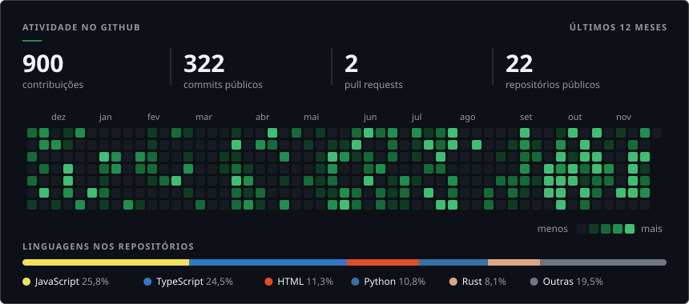

<h1 align="center">George Peixoto</h1>

<p align="center">
  <a href="https://georgepxtodev.vercel.app">
    
  </a>
</p>

<p align="center">
  <a href="https://georgepxtodev.vercel.app"></a>
  <a href="https://www.linkedin.com/in/george-peixoto-1a7004360/"></a>
  <a href="mailto:georgepxto@gmail.com"></a>
</p>

---

```ts
const george = {
  role: "Desenvolvedor Web Full Stack",
  base: "Parnaíba, PI — Brasil",
  status: "Disponível para projetos freelance",

  stack: {
    frontend: ["React", "TypeScript", "Vite", "Vue"],
    backend: ["Node.js", "NestJS", "Express"],
    data: ["MariaDB", "SQLite", "Supabase", "Firestore"],
    deploy: ["Vercel", "Hostinger Cloud", "VPS"],
  },

  approach: [
    "do levantamento de requisitos ao deploy",
    "interfaces limpas, sem excesso",
    "infraestrutura que o cliente controla",
  ],

  languages: { pt: "nativo", en: "avançado" },
};
```

## O que eu construo

Sistemas web completos para clientes, sites para negócios locais e produtos próprios. Cuido de todas as etapas: conversa com o cliente, modelagem do banco, front-end, back-end, hospedagem e manutenção depois da entrega.

## Para clientes

<table>
  <tr>
    <td width="50%" valign="top">
      <h3>Plataforma de vídeos</h3>
      
      
      <p>Plataforma de conteúdo em vídeo do Instituto OIG, em produção e mantida sob contrato mensal recorrente.</p>
    </td>
    <td width="50%" valign="top">
      <h3>Gestão de assistência social</h3>
      
      <p>Cadastro e validação de beneficiários por CPF/CNPJ, níveis de acesso, galerias por etapa de reforma, mapa de calor por bairro, exportações e auditoria.</p>
      
      
      
      
    </td>
  </tr>
  <tr>
    <td width="50%" valign="top">
      <h3>Escala OIG</h3>
      
      <p>Geração automática de escalas e folgas (12x36, 5x2, 5 folgas/mês) para colaboradores de várias cidades, com feriados por cidade e quadro de avisos.</p>
      
    </td>
    <td width="50%" valign="top">
      <h3><a href="https://lunnapijama.com.br">Lunna Pijama</a></h3>
      
      <p>Landing page de uma loja de pijamas em Teresina, pensada para aparecer nas buscas locais do Google.</p>
      
    </td>
  </tr>
</table>

## Produtos e projetos próprios

<table>
  <tr>
    <td width="50%" valign="top">
      <h3>TakeOne</h3>
      
      <p>Gestão para negócios cinematográficos, com design system editorial próprio: bordas finas, sem sombras, tipografia serifada.</p>
      
      
      
    </td>
    <td width="50%" valign="top">
      <h3>Caça-Cliente</h3>
      
      <p>Encontra empresas locais sem site para prospecção, com scraping, progresso em tempo real via SSE e pausa para resolver CAPTCHA.</p>
      
      
      
      
    </td>
  </tr>
  <tr>
    <td width="50%" valign="top">
      <h3>Giz</h3>
      
      <p>Painel de gestão para professores, com tema escuro e modo claro.</p>
      
      
    </td>
    <td width="50%" valign="top">
      <h3>MonitorHub</h3>
      
      <p>Acompanha em um só lugar as páginas de status de bancos brasileiros e do PIX.</p>
    </td>
  </tr>
  <tr>
    <td colspan="2" valign="top">
      <h3><a href="https://github.com/georgepxto/tvtclc6k">Início</a></h3>
      
      <p>Otimização de uma Google TV TCL e launcher próprio, leve e direto: relógio, entradas, Wi-Fi e ajustes a um clique.</p>
      
    </td>
  </tr>
</table>

## Stack

<table>
  <tr>
    <td width="170"><b>Front-end</b></td>
    <td></td>
  </tr>
  <tr>
    <td><b>Back-end</b></td>
    <td></td>
  </tr>
  <tr>
    <td><b>Dados</b></td>
    <td></td>
  </tr>
  <tr>
    <td><b>Deploy e ferramentas</b></td>
    <td></td>
  </tr>
</table>

## Trajetória

<table>
  <tr>
    <td width="90" valign="top"><b>2018</b></td>
    <td>Técnico em Edificações — SENAI<br>Programa Aprendiz Legal em ocupações administrativas — CIEE</td>
  </tr>
  <tr>
    <td width="90" valign="top"><b>2024</b></td>
    <td>Análise e Desenvolvimento de Sistemas — UNINASSAU<br>Front-end e UI/UX Design — Origamid<br>Suporte técnico e, depois, supervisão de suporte — OIG Gaming<br>Protótipo de biblioteca virtual em Vue + Node.js — projeto de extensão</td>
  </tr>
  <tr>
    <td width="90" valign="top"><b>2026</b></td>
    <td>Início como freelancer: sistemas para o grupo OIG e sites para negócios locais<br>TakeOne, Caça-Cliente e portfólio pessoal</td>
  </tr>
</table>

## Atividade

<p align="center">
  
</p>

---

<p align="center">
  Precisa de um sistema, uma landing page ou um produto do zero? <a href="mailto:georgepxto@gmail.com">Vamos conversar.</a>
</p>
